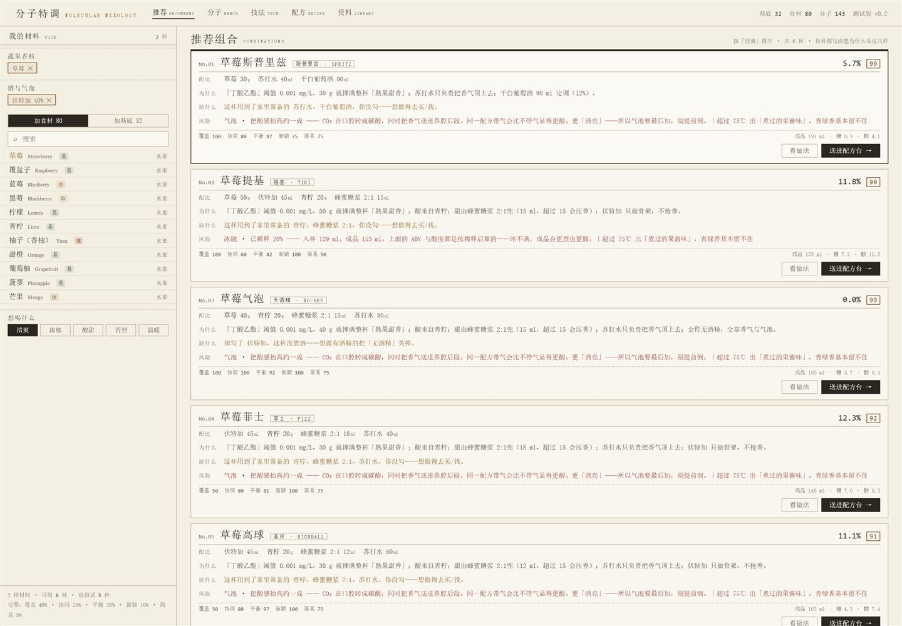
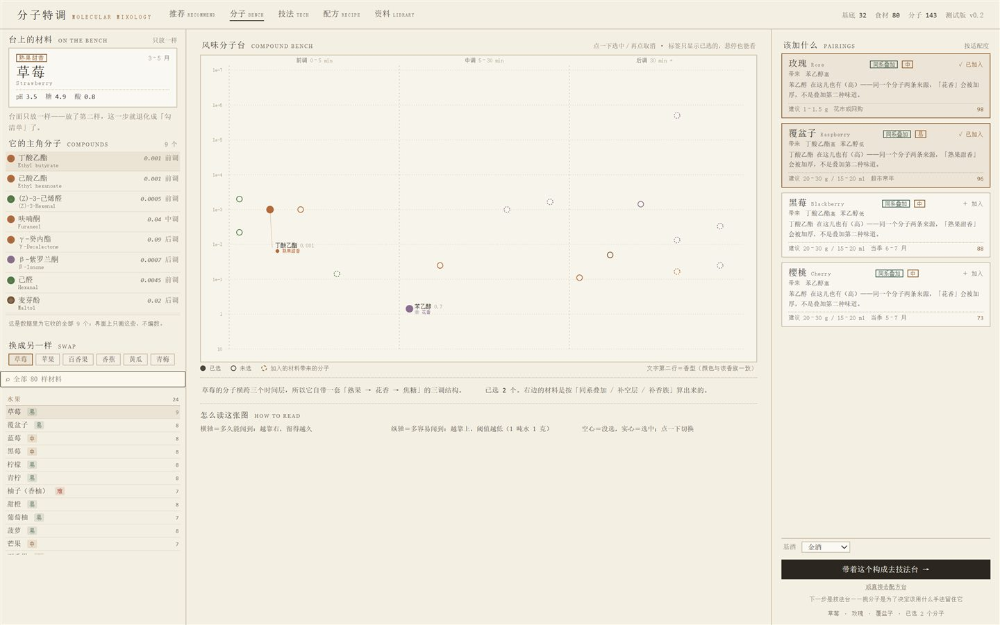
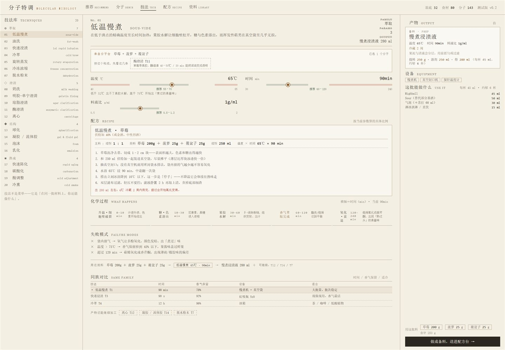
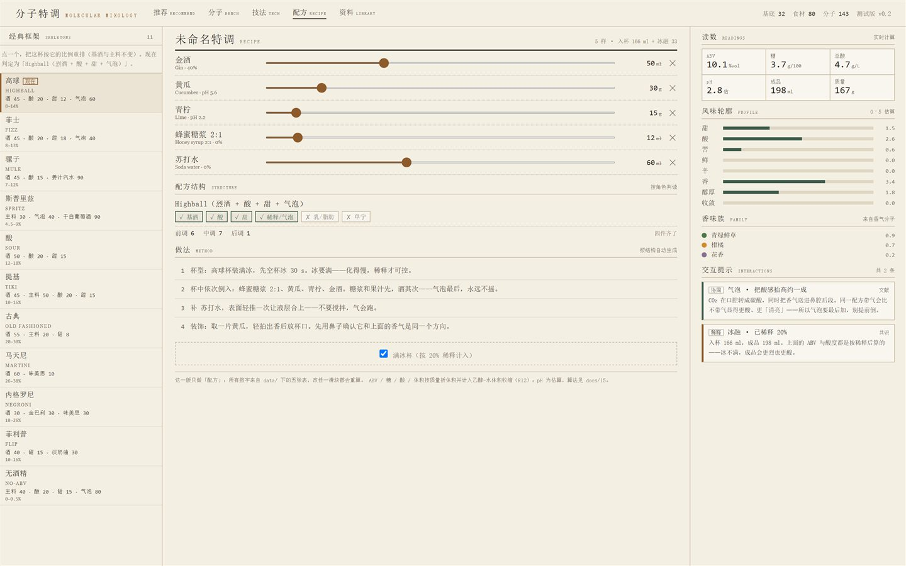
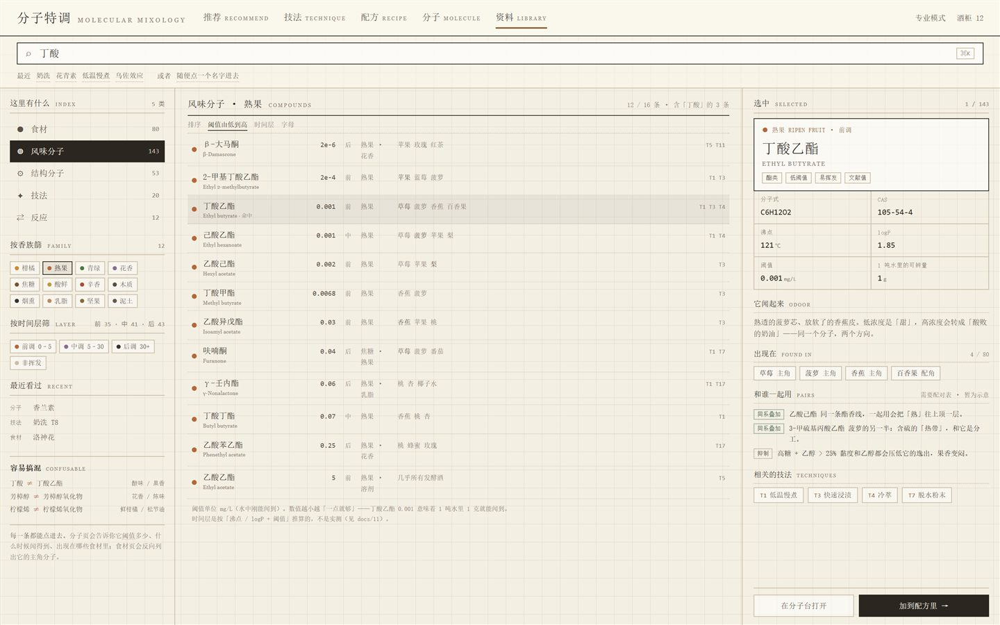
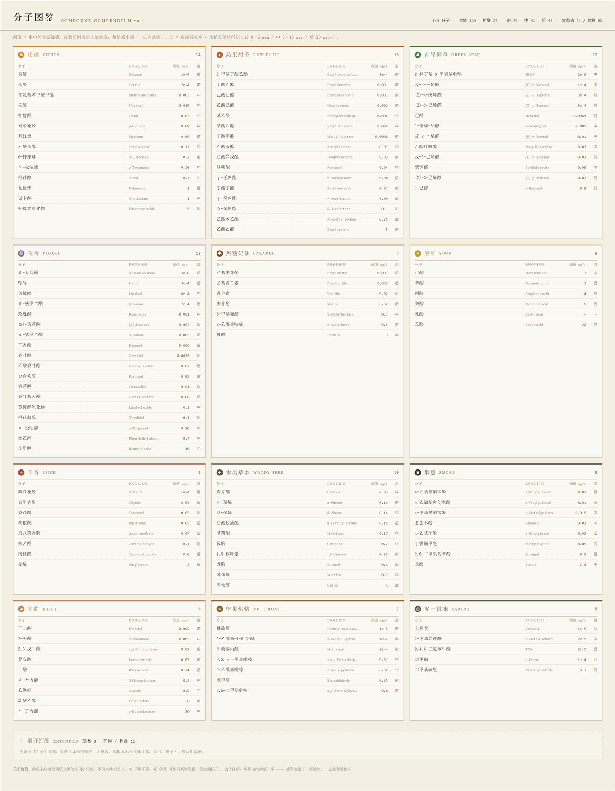
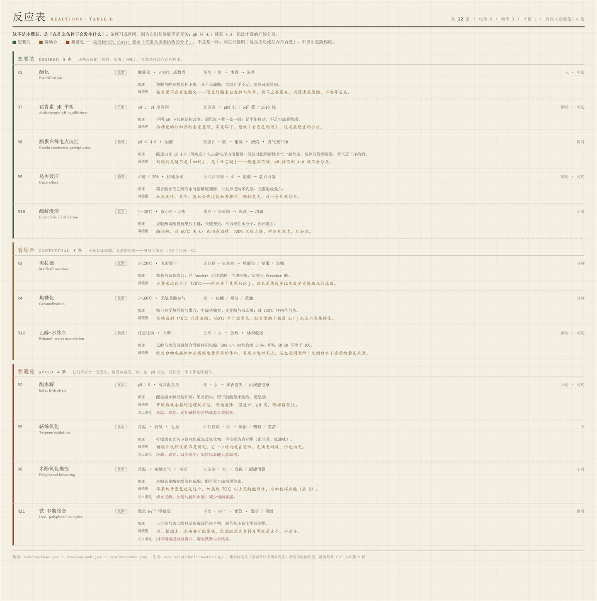
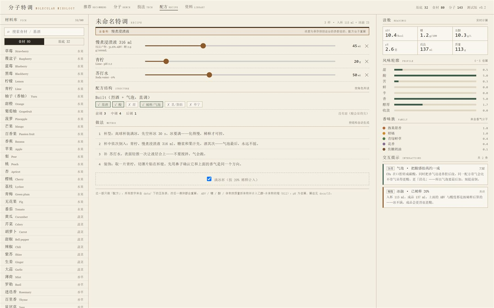

# 分子特调 · Molecular Mixology

**一个以食品化学和调酒学为基础的风味工作台。**
查食材里的关键风味分子、看分子之间怎么互相作用、按手里的材料推荐能做的酒、把分子构成转成技法和具体配方。

不是配方收集站，是**「为什么这杯是这样」的可解释版本**。



---

## 它解决什么问题

调酒书告诉你「青柠 20 ml、糖浆 15 ml」，但不告诉你：

- 为什么蜂蜜配烟熏比配白糖更耐喝？
- 为什么柑橘汁放一小时就不香了？
- 为什么牛奶遇到酸会自己分层澄清？
- 为什么同一颗草莓，冷萃和 65 ℃ 慢煮闻起来不是同一种东西？

这套东西的答案都指向**分子**：哪一种分子、阈值多少、什么时候闻得到、和什么分子一起会盖掉谁。所以它的数据底座不是配方，是**四张表**：

| 表 | 内容 | 数量 |
|---|---|---|
| 食材 | 水果 / 蔬菜 / 香草 / 香料 / 花与茶 / 干果 / 坚果 / 乳 | 80 条 |
| 基底液体 | 烈酒 / 发酵酒 / 气泡 / 甜味剂 / 乳 | 32 条 |
| 风味分子 | CAS、沸点、logP、嗅觉阈值、挥发时间层、香族 | 143 条 |
| 结构分子 | 多酚、色素、蛋白、胶体、辣、酸、离子、酶 | 53 条 |

外加 **12 条反应**（想要的 / 看场合 / 要避免）和 **20 条分子调酒技法**。

---

## 五个页面

### ① 推荐台 —— 我有什么材料，能做什么

勾几样材料 + 选「想喝什么」，出 6 杯。每杯都写清楚：配比、为什么是这几样、缺什么、风险、五项打分。

**11 个经典骨架**参与竞争，不是模板套娃：

`高球 / 菲士 / 骡子 / 斯普里兹 / 酸 / 提基 / 古典 / 马天尼 / 内格罗尼 / 菲利普 / 无酒精`

选哪个由两件事决定：**心情**（清爽/浓郁/酸甜/苦烈/温暖）和**主料的香族**（辛香→古典，花香→马天尼，乳脂→菲利普）。


### ② 分子台 —— 只有一样材料也能开始

把唯一的一样材料「放上台面」，展开它的主角分子，用**时间层 × 阈值**的散点看清楚它的香气结构——哪一层空着，就去补那一层。

右侧推荐的材料分三种关系：**同系叠加**（同一条分子通路）、**补空层**（同族但在你缺的时间层）、**补香族**（整杯缺的那个方向）。推荐按「好不好买」排序，不是按分数排。



### ③ 技法台 —— 20 条分子调酒技法

低温慢煮 / 油洗 / 快速浸渍 / 冷萃 / 旋转蒸发 / 冷冻浓缩 / 脱水粉末 / 奶洗 / 明胶-单宁澄清 / 琼脂澄清 / 酶澄清 / 离心 / 球化 / 凝胶 / 泡沫 / 乳化 / 快速陈化 / 碳酸化 / 酸调整 / 冷熏。

每条都有：**参数滑块 + 推荐区间 + 危险区间**、**化学过程时间轴**、**失败模式**、以及**按当前参数算出来的具体配方**（溶剂多少 ml、投料多少 g、每一步几分钟、出多少毫升）。



### ④ 配方台 —— 只算比例和结构

左栏是 11 个经典骨架，点一条就把这杯按它的比例重排；中间是读数（ABV / 糖 / 总酸 / pH / 体积）、风味轮廓、结构判读（浑浊、可澄清性、pH 敏感色、蛋白×单宁、油脂、气泡）、做法步骤。



### ⑤ 资料库 —— 查

分子 143 / 结构分子 53 / 技法 20 / 反应 12 / 食材 80，全表可搜，每个名字都能点到相关的东西。



---

## 四个数据表长什么样





---

## 跑起来

```bash
pnpm install
pnpm dev          # http://127.0.0.1:5178
pnpm build        # 产出 dist/，双击 dist/index.html 也能离线用
```

Windows 上直接双击 `启动.bat`。

> 没有 pnpm：`npm i -g pnpm`，或者用 corepack。

---

## 目录

```
src/
├─ App.tsx               五个页签 + 交接状态
├─ engine/               全部计算在这里，页面里不写公式
│  ├─ calc.ts            读数：ABV / 糖 / 酸 / pH / 体积 / 风味 / 骨架 / 做法
│  ├─ compose.ts         11 个经典骨架 + 五维打分
│  ├─ pairing.ts         分子台：同系叠加 / 补空层 / 补香族、克数估算
│  ├─ prep.ts            备料：投料 → 产物（体积、ABV、糖、溶剂损失）
│  ├─ recipe.ts          20 条技法的具体配方
│  ├─ rules.ts           9 条交互规则（带证据等级）
│  └─ data.ts types.ts
└─ views/                推荐 / 分子 / 技法 / 配方 / 资料

data/                    6 张运行时表
docs/                    设计与决策记录（24 篇 + ADR-001~018）
screenshots/             README 用图
scripts/                 一次性生成脚本（把 data 变成可读的 HTML 表）
```

---

## 三条链路

```
推荐台 ──「送进配方台」──────────────→ 配方台
分子台 ──「带着这个构成去技法台」──→ 技法台 ──「做成备料」──→ 配方台（带备料行）
```

配方台收到的是**备料**（「慢煮浸渍液 316 ml · 31.6% ABV · 糖 2.9 g/100mL」），不是原材料清单——因为一杯酒里放的是浸渍液，不是生草莓。



---

## 这一版诚实地说，还缺什么

1. **没有持久化**：刷新就没了，配方本 / 酒柜是界面占位
2. **没有手机断点**：1440 宽设计，窄屏会挤
3. **备料 ABV 是模型估算**：按溶剂体积 + 食材含水 + 浸出率算，不是实测
4. **口感数据是分级估算**：分子浓度只有 trace/low/mid/high/dominant 五档，不是实测含量
5. **阈值只到数量级**：文献值也有 3–10 倍个体差异
6. **结构成分没全部进读数**：53 条里只有一部分参与计分
7. **分子配对是算出来的**，不是人工审核过的表——它只能保证「有理由」，不能保证「一定好喝」

写这些不是免责，是因为**这套东西的价值就在「知道自己不知道什么」**。所有估算在界面上都标了「估」，所有规则都标了证据等级（文献 / 机理 / 共识 / 待验）。

---

## 数据来源与边界

- 阈值、沸点、CAS 来自公开文献与 PubChem（143 条全部用 PubChem PUG REST 核对过 CAS）
- 风味描述是通俗名，不是感官评测结果
- **它不是分子动力学模拟器**：只做规则 + 查表 + 示意，不做量子化学
- 结构式只有二维骨架

---

## License

MIT
